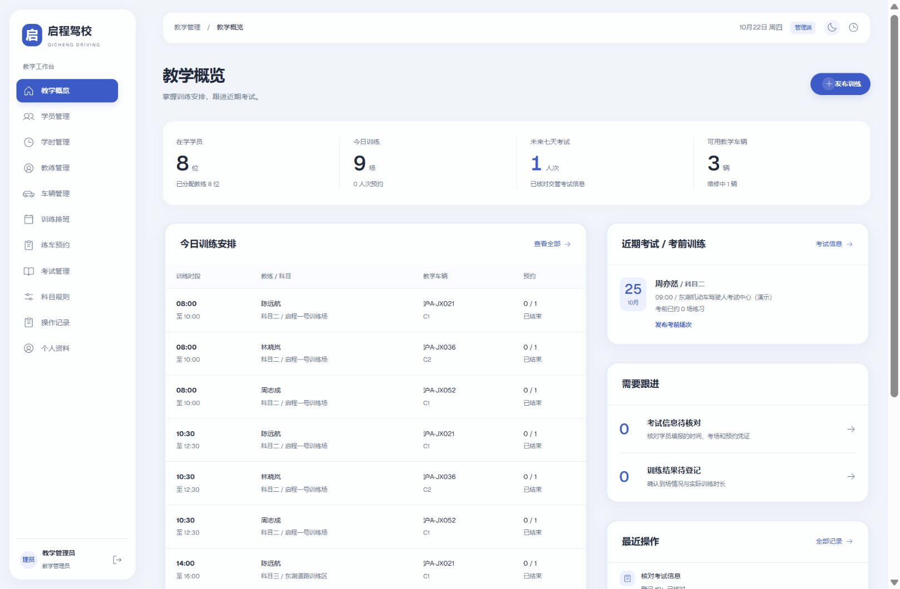
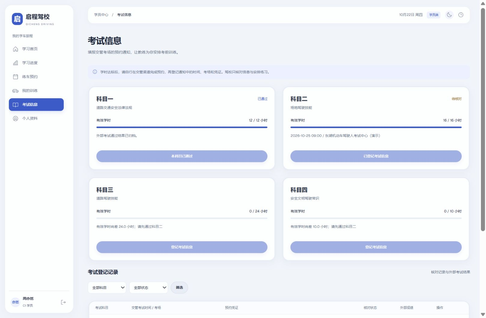

# 启程驾校

**把学时、练车和考试信息放在一起，让学车进度清晰可见。**

面向学员和教学管理员的驾校管理系统。学员查看四科学习进度、预约练车，管理员安排教练与车辆、记录学时，并跟进考前训练。

[快速开始](#快速开始) · [查看功能](#学员端与管理端) · [了解考试流程](#考试与考前练习) · [运行测试](#测试)

## 教学工作台



管理端在同一页面查看今日训练、近期考试和待处理事项。截图中的人员和业务信息为演示数据。

## 学员端与管理端

| 学员 | 教学管理员 |
| --- | --- |
| 查看科目一至四的学时、成绩和学习进度 | 维护学员档案、分配教练、配置科目规则 |
| 选择练车日期、教练和车型，预约或取消场次 | 管理教练与车辆，发布训练场次 |
| 登记交管渠道的考试通知，查看核对状态 | 录入训练结果和学时，核对考试信息 |
| 查看自己的训练安排，维护个人资料 | 查看教学概览和操作记录 |



## 从预约练车到学时入账

1. 管理员选择科目、教练、车辆和时间，发布练车场次。
2. 学员查看可用场次并预约。系统检查车型、名额和时间冲突。
3. 训练结束后，管理员登记实际有效训练时长，系统生成学时记录。
4. 学员在学习进度中查看各科有效学时和剩余要求。

系统会检查教练与车辆的排班冲突，并防止同一预约重复计入学时。

## 考试与考前练习

学时达到系统设置的要求后，学员可在交管渠道办理考试预约。预约成功后，将考试时间、考场和凭证登记到系统，管理员核对信息并根据考试日期安排练习。考试成绩由管理员依据外部结果登记。

系统会检查考试登记与当天练车预约的冲突。学员撤回系统内的登记后，外部预约状态需另行核对。

## 快速开始

需要安装 **Node.js 24 或更新版本**。在项目目录运行：

```powershell
node server/index.mjs
```

访问 [http://127.0.0.1:3210](http://127.0.0.1:3210)。Windows 用户也可以双击 `start.cmd` 启动，在启动窗口按 `Ctrl+C` 停止。

首次运行会创建本地演示数据库。登录页面可直接选择演示账号，也可以手动输入：

| 角色 | 账号 | 密码 |
| --- | --- | --- |
| 管理员 | `admin` | `Admin2026!` |
| 学员 | `student` | `Drive2026!` |

## 技术结构

前端使用 HTML、CSS 和 JavaScript，后端使用 Node.js HTTP 服务，业务数据保存在 SQLite 中。

```text
public/    网页界面与本地字体资源
server/    接口、业务规则与数据库初始化
tests/     接口与数据库迁移测试
tools/     检查、备份与停止服务工具
```

数据库保存在 `data/`。Windows 用户可运行 `backup.cmd`，将数据库备份到 `backups/`。

## 测试

```powershell
node tools/check.mjs
node --test tests/*.test.mjs
```

测试覆盖权限、学时门槛、排班冲突、练车预约、考试信息和旧数据迁移等场景，使用独立测试数据库。

系统默认监听本机地址，面向单驾校本地演示。科目学时门槛和成绩通过线为可配置的演示规则。
